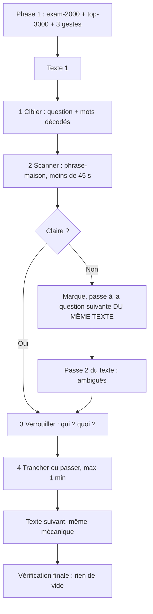

# Procédure DELF B2 — compréhension écrite (version élève)

**Principe en une phrase :** les erreurs viennent surtout du
vocabulaire des OPTIONS — on apprend les mots d'abord (phase 1),
on décode les autres avec 3 gestes, on trouve la phrase qui
porte la réponse, on vérifie qui fait quoi, on décide. Texte par
texte, jamais en deux passes globales.

## 1. Schéma — 4 temps, texte par texte



En texte : **pour chaque texte, dans l'ordre : survol de ses
questions (~1 min) → passe 1 (radar, dans l'ordre du texte) →
passe 2 (ambiguës DU MÊME texte) → texte suivant.** On ne quitte
jamais un texte avant d'avoir fini sa passe 2 : revenir à un
texte 30 minutes plus tard, c'est le relire entièrement (3 à
4 minutes perdues). Vérification globale : 5 minutes à la fin.

## 2. Phase 1 — vocabulaire (avant l'examen)

### 2.1 Quoi apprendre, dans quel ordre

1. **Exam-2000 d'abord, par diagnostic.** Sur la liste des 2000
   mots d'examen, coche ceux que tu connais déjà (sens exact, pas
   « ça me dit quelque chose »). Apprends SEULEMENT les manquants.
2. **Top-3000 général ensuite, par bandes** : 1–1000, puis
   1001–2000, puis 2001–3000.
3. **La liste noire dès la semaine 1** (§2.3) : ce ne sont pas des
   mots à deviner, ce sont des mots à CONNAÎTRE.
4. **Les 3 gestes comme réflexes** (§2.2), entraînés sur des
   options, pas récités comme théorie.
5. **Les listes sont FOURNIES** (fichiers de la méthode). Ne les
   régénère pas toi-même : un générateur de fréquences ne donne
   pas la liste validée (formes au lieu de lemmes, autre corpus,
   autre ordre).

### 2.2 Les 3 gestes — une seule numérotation, partout

Même numéros ici, au §3, sur la carte de poche (§7) et dans la
vidéo (§8). On les applique dans l'ordre 1 → 2 → 3, et on
s'arrête dès qu'on reconnaît — puis on VÉRIFIE (§2.3).
Temps par type de mot (repère) : instantané 2–5 s ;
terminaison/verbe 5–10 s ; famille + vérification 15–30 s.
Règle d'abandon : si la base n'est pas connue après ~10 s de
recherche, le mot est abandonné (il reste inconnu, on raisonne
sans lui).

**Frontière entre le Geste 2 et le Geste 3 :** le Geste 2
reconnaît le mot grâce à sa terminaison internationale, sans
avoir besoin de connaître la base ; le Geste 3 retrouve une base
française connue en enlevant le début ou la fin du mot.

**Geste 1 — Gratuit : nom propre / nombre.** Majuscule au MILIEU
d'une option, ou nombre → gratuit, pas besoin de traduire. Ex. :
Bruxelles, Catan, PIX. **Attention : une majuscule en DÉBUT
d'option est souvent un VERBE (Exporter, Repeindre), pas un nom.**

**Geste 2 — Transparent.** Appuie-toi uniquement sur les mots
transparents que tu maîtrises déjà à 100 % (internationaux ou
anglais connus) — sinon, le geste ne s'applique pas.
a) Orthographe identique, même sens. Ex. : chalet, glutamate,
   intact, senior, parmesan, adverse, bouillon, pesticide,
   coworking, umami.
b) Terminaison sûre — NOMS ET ADJECTIFS SEULEMENT, jamais un
   verbe conjugué. -tion, -sion, -ité, -ique, -isme, -iste,
   -able, -ible, -al. Ex. : durable, virtuel, ponctuel,
   conditionnel. **Test obligatoire : le mot est-il un verbe
   dans cette phrase ? Si oui, le geste ne s'applique pas.**
   Ex. : « la formation ne dure pas » — dure est le verbe
   durer, pas un nom en -ure.
c) Verbe en -er dont le radical EST un mot anglais connu. Ex. :
   tolérer, analyser, contrôler, organiser, utiliser, signer,
   tester, importer, détecter.
d) Ressemblance : le mot ressemble à un anglais que tu connais
   à 100 % ? Propose un sens, puis VÉRIFIE (§2.3). Ex. positif :
   ambitieux ~ ambitious → ça colle, on garde. Ex. négatif :
   mitigé ~ mitigated → ça ne colle pas (mitigé = partagé) →
   on rejette.

**Geste 3 — Famille.** Restaure la forme de base D'ABORD :
composé → composer, commande → commander, présentiel → présent.
Puis enlève le début (dé-, re-, pré-, in-, contre-, télé-, ex-,
pro-, sur-, en-) ou la fin (-eux/-euse, -ure, -iel, -ance,
-ence, -eur, -if/-ive, -aire, -ment). La base doit être un mot
français connu ET le sens composé doit coller à la phrase. Ex. :
repeindre (re- + peindre), inchangé, inefficace, déconnexion,
présentiel. **Ne déduis jamais démentir de dé- + mentir**
(« arrêter de mentir » colle à presque toutes les phrases,
mais c'est faux) : démentir = nier, à apprendre par cœur — il
est dans la liste noire.

### 2.3 Règle d'or + liste noire (apprendre, ne pas deviner)

Tu n'as le droit de « reconnaître » un mot que si les 3
conditions sont réunies : (1) le mot anglais (ou la base) est un
mot que tu connais VRAIMENT ; (2) en remplaçant le mot par le
sens deviné, la phrase **ne crée pas d'absurdité** avec le texte
(la vérification ne demande pas un sens « exact » — que tu ne
peux pas vérifier si tu ne connais pas le mot — seulement
l'absence d'absurdité) ; (3) le mot n'est pas dans la liste
noire. Sinon → inconnu, raisonne sans lui. **La vérification NE
RATTRAPE PAS mitigé ni redouter** — leurs sens devinés collent
grammaticalement à la phrase. C'est précisément pour ça qu'ils
sont dans la liste noire : la liste protège là où la
vérification ne peut pas.

Liste noire — définitions en français simple, avec le piège de
ressemblance pour chaque mot (aucun mot d'une autre langue dans
cette liste) :
saluer = dire bonjour à quelqu'un. Piège : on croit parfois que
c'est un salut militaire ; retiens : dire bonjour.
souplesse = capacité à s'adapter, à plier sans casser.
saturer = remplir à tel point qu'on ne peut plus ajouter (une
salle saturée = pleine à craquer). Piège : en français courant,
« saturer » veut surtout dire « trop plein », pas seulement un
sens de chimie.
stagner = ne plus avancer, rester au même point. Piège : ne
vient pas de « stage » ; stagner = ne pas progresser.
panne = quand une machine ne fonctionne plus, quand elle est
cassée. Piège : ne veut pas dire « panneau » ; une panne,
c'est un arrêt.
se racheter = réparer une faute, se faire pardonner. Piège : ne
veut pas dire « acheter de nouveau » ; se racheter, c'est se
faire pardonner.
avalés = mangés, descendus dans la gorge. Piège : sa forme fait
penser au mot « disponible » dans une autre langue ; en
français, « avalé » = mangé.
enchères = vente où c'est celui qui propose le plus d'argent qui
achète. Piège : ne veut pas dire « cher » ; les enchères,
c'est une vente aux offres.
mitigé = partagé, à moitié réussi (ni bon ni mauvais). Piège :
ne veut pas dire « adouci » ou « atténué » ; mitigé = partagé.
redouter = avoir peur, craindre. Piège : ne vient pas de
« douter » ; redouter = craindre, pas douter.
démentir = nier, dire que ce n'est pas vrai. Piège : ne vient
pas de « dé- + mentir » (arrêter de mentir) ; démentir = nier.
repérer = trouver où se trouve quelque chose. Piège : ne veut
pas dire « réparer » ; repérer = trouver, pas réparer.
mensuel = qui a lieu chaque mois. Piège : ne veut pas dire
quelque chose sur le corps ; mensuel = chaque mois.
réclamer = exiger, demander avec force. Piège : ne veut pas
dire « recommencer » ; réclamer = demander avec insistance.
pâte = matière molle pour cuisiner (pâte à pain, pâte à tarte).
Piège : ne veut pas dire « pâté » (la viande) ; la pâte, c'est
pour cuisiner.
levier = outil pour soulever, ou moyen pour agir. Piège : ne
veut pas dire « levée » ; un levier, c'est un outil ou un moyen
d'action.
annuler = supprimer, dire que ça n'aura pas lieu. Piège : ne
veut pas dire « annoter » (écrire une note) ; annuler =
supprimer.
retrait = le fait de retirer, d'enlever. Piège : ne vient pas
de « trait » ; un retrait = on enlève quelque chose.
retraite = le moment où on arrête de travailler, à la fin de sa
vie de travail. Piège : ne vient pas de « traite » ; la
retraite = la fin du travail.
proche = qui est près, à côté. Piège : ne veut pas dire
« cher » (qui coûte beaucoup) ; proche = près.
reproche = blâme, ce qu'on dit à quelqu'un qui a mal fait.
Piège : ne vient pas de « proche » ; un reproche = un blâme,
pas une proximité.
répartir = distribuer, partager entre plusieurs. Piège : ne
vient pas de « partir » ; répartir = distribuer, pas partir.
compromettre = mettre en danger, abîmer la situation de
quelqu'un. Piège : ne vient pas de « promettre » ;
compromettre = mettre en danger, pas promettre.
enseigne = le nom écrit sur la façade d'un magasin. Piège : ne
vient pas de « enseigner » ; une enseigne = le nom d'un
magasin, pas un professeur.
porter = tenir sur soi, transporter (porter un sac). Piège : ne
veut pas dire « port » (le lieu des bateaux) ; porter, c'est
tenir sur soi.
concurrencer = être en concurrence, rivaliser avec quelqu'un.
Piège : ne veut pas dire « courir ensemble » ; concurrencer =
rivaliser.
verse = il/elle fait couler un liquide (il verse de l'eau).
Piège : ne veut pas dire « vers » (le petit poème) ; « il
verse » = il fait couler.
travailler = faire son métier, son travail. Piège : ne veut pas
dire « voyager » ; travailler = faire son travail, pas voyager.
matériel = les objets, les outils pour un travail (le matériel
informatique). Piège : ne veut pas dire « maternel » (de la
mère) ; le matériel = les outils, les objets.
personnel = les gens qui travaillent dans un lieu (le personnel
d'un hôtel). Piège : ne veut pas dire « personnel » au sens de
« privé, à soi » ; le personnel = les employés.
car = parce que. Piège : ne veut pas dire « voiture » ;
« car » = parce que.
assister à = être présent à quelque chose (assister à un cours
= être là). Piège : ne veut pas dire « aider » ; « assister
à », c'est être présent.
décevoir = rendre triste, ne pas être à la hauteur de ce qu'on
espérait. Piège : ne veut pas dire « tromper » ; décevoir = ne
pas répondre à l'espoir.
sensible = délicat, émotif, qui ressent beaucoup. Piège : ne
veut pas dire « raisonnable » ; sensible = délicat, émotif.
supporter = tolérer, endurer (supporter le bruit = le
tolérer). Piège : ne veut pas dire « soutenir » (aider) ;
supporter = tolérer.

### 2.4 Rythme et contrôle (repères)

- **30 mots nouveaux par jour, 6 jours par semaine**
  (lundi–samedi), dimanche = révision seule. 3000 ÷ 30 = 100 jours
  ≈ 17 semaines pour le top-3000, + 3 semaines de diagnostic
  exam-2000 + gestes au début → **~20 semaines (≈ 5 mois).**
- **Anki** (gratuit) : une carte par mot. Recto : mot français +
  1 phrase exemple. Verso : sens exact. Étiquettes : une pour
  l'exam-2000, une pour le top-3000. Ne jamais apprendre une
  liste nue : sans phrase, le mot ne revient pas le jour J.
  Option : regrouper par thèmes (travail, environnement,
  numérique, santé, éducation) si ça aide.
- **Révision J+1, J+3, J+7, J+30.** Un mot raté repart à J+1.
- **Contrôle hebdomadaire** : 50 mots tirés au hasard parmi les
  mots appris. Seuil proposé : **≥ 85 %**. Sous 85 % → semaine
  suivante à 20 mots/jour + révision des ratés.
- **Journal d'erreurs** : mot | sens deviné | vrai sens | règle
  (geste, liste noire, vérification manquée, radar manqué). Et
  deux types : « mot inconnu » vs « lecture fausse ». Si la
  majorité est « mot inconnu », augmente le vocabulaire ; si
  c'est « lecture fausse », travaille la procédure (§3).
- **Test de préparation** (repère) : 3 textes d'entraînement
  jamais lus ; seuil proposé : **≥ 90 % des mots d'options
  connus ou devinables** (noms propres et nombres exclus,
  toujours gratuits). En dessous, prolonge la phase 1 de
  2 semaines sur la bande la plus faible.

## 3. Jour J — par texte, en 4 temps

**Règle de structure :** pour chaque texte, survol de SES
questions (~1 min) → passe 1 (radar, dans l'ordre du texte) →
passe 2 (ambiguës DU MÊME texte) → texte suivant. On ne quitte
jamais un texte avant d'avoir fini sa passe 2.

### 3.1 Les 4 temps par question

**1. Cibler (question + options, mots décodés).** Lis la question
et les options ensemble. Repère les mots DÉCISIFS de chaque
option : le mot ou le nombre qui fait la différence entre deux
options, surtout si la phrase n'en contient qu'un qui change
l'image entière. **Décode ces mots décisifs AVANT de chercher
dans le texte**, avec les gestes 1 → 2 → 3. Rappel : une
majuscule en début d'option est souvent un verbe (Exporter,
Repeindre). Si un mot décisif est inconnu après les gestes, il
reste inconnu : tu le notes comme tel et tu raisonnes sans lui.

**2. Scanner (phrase-maison, moins de 45 s).** Trouve la phrase
du texte qui parle de la même chose que la question — elle
contient un synonyme ou un équivalent du mot décisif (jamais
forcément le même mot). La phrase-maison est rarement au début
du texte : balaye dans l'ordre, sans relire tout le paragraphe.
Si la phrase-maison est introuvable en moins de 45 s : marque la
question et passe à la suivante DU MÊME TEXTE (ne devine jamais
sans avoir décodé les mots décisifs — mais si tu les as décodés
et que la phrase reste introuvable, marquer est la bonne
réponse, pas deviner).

**3. Verrouiller (qui ? quoi ?).** Compare la phrase-maison aux
options, mot à mot, en particulier le mot décisif. Si un mot
décisif contredit le texte → élimine l'option. Si deux options
restent, pèse : laquelle reprend le sens de la phrase-maison,
laquelle le déplace (sujet, temps, quantité, côté gagnant d'une
comparaison) ?
**Contrôle anti-piège (optionnel, en cas de doute seulement).**
Quand une option reprend LITTÉRALEMENT un mot du texte, ou quand
tu hésites entre deux options, pose 3 questions simples :
(1) Est-ce exactement la même action / la même idée ?
(2) Est-ce la même personne (ou la même chose) qui fait
l'action ?
(3) Le mot parle-t-il de la même chose (de quoi ? où ?
pourquoi ?) que dans le texte ?
Si l'une des réponses diffère → élimine. **Un mot du texte dans
une option n'est ni un piège automatique, ni une bonne réponse
automatique** : vérifie toujours qui fait l'action et à quoi ce
mot se rapporte.
**Si le texte dit plus d'une chose sur le même sujet, ne
paraphrase jamais au-delà de la phrase-maison.** Un mot copié
est normal et souvent juste ; ce qui tue, c'est le sens déplacé.

**4. Trancher ou passer (max 1 min en passe 1).** Si tu as la
réponse, coche et avance. Sinon, marque et passe à la question
suivante DU MÊME TEXTE — tu reviendras en passe 2 du texte.
Une question ambiguë ne doit jamais dépasser 2–2,5 minutes au
total (passe 1 + passe 2). À la fin du texte : vérifie que
toutes ses questions ont une réponse, même provisoire.

### 3.2 Cas particulier : appariement (3 avis, affirmations)

Dans l'exercice d'appariement, les options ne sont que « Personne
A / Personne B / Personne C » et l'affirmation est dans la
question — le radar s'inverse : **les mots décisifs sont dans
l'affirmation**, et on balaie les 3 courts avis pour trouver
celui qui contient ces mots (ou leurs synonymes) avec le même
sens. Même mécanique que §3.1, mais appliquée à l'affirmation
d'abord, puis aux 3 textes.

**Mini-exemple — exemple fabriqué pour illustrer (pas un vrai sujet) :**
Affirmation : « Les cours en ligne permettent de mieux organiser son temps. »
Avis A (Claire) : « J'aime les cours en ligne parce que je peux choisir quand je travaille, le matin ou le soir. »
Avis B (Théo) : « Les cours en ligne, c'est pratique, mais je me sens seul devant mon écran et je perds ma motivation. »
Avis C (Inès) : « Je préfère les cours en classe : le professeur explique et on peut poser des questions tout de suite. »
Réponse : A.
Pourquoi : « organiser son temps » se retrouve chez A (« choisir quand je travaille ») ; B parle de solitude, C de la classe.

### 3.3 Cas particulier : question globale (ton, intention)

Il n'y a PAS de phrase-maison unique pour « Quel est le ton de
cet article ? » ou « Quel est l'objectif principal ? » — le
radar par mot-clé échoue. Méthode : lis le chapeau (titre +
premières phrases) et la conclusion (dernières phrases,
péroraison). Le ton global = celui qui couvre TOUT le texte,
pas celui d'un seul paragraphe. Un paragraphe qui attaque ne
fait pas un texte polémique si le texte défend une cause ;
une ironie locale ne fait pas un texte moqueur si la conclusion
est un plaidoyer. Voir l'exemple 6 (§4).

## 4. Exemples déroulés (vrais sujets, clés officielles)

Les phrases du texte sont citées exactement. Les options sont
données dans leur sens complet.

### Exemple 1 — radar propre (p03q1, clé B, repère ~25 s)

**Question :** « Pour défendre son initiative, Cécile Gauchou
s'appuie sur une méthode qui s'applique dans les … »
**Options :** A. universités — B. entreprises — C. bibliothèques.
**Phrase-maison :** « L'aménagement flexible se pratique dans
les espaces de travail alors pourquoi ne pas le faire à
l'école ? »
**Déroulé.** Radar : l'aménagement flexible « se pratique dans
les espaces de travail » → B (entreprises). C (bibliothèques) :
il y a bien « un coin bibliothèque avec des fauteuils », mais
c'est un coin DANS la classe — le mot parle d'autre chose que
la méthode (voir le contrôle §3.1, temps 3). A (universités) :
jamais mentionnées.

### Exemple 2 — piège, recombinaison de deux mots vrais (p24q2, clé B, repère ~40 s)

**Question :** « Quel est l'un des problèmes majeurs du secteur
agricole aujourd'hui ? »
**Options :** A. La féminisation de la profession — B. La
réduction du nombre d'agriculteurs — C. Le vieillissement des
installations agricoles.
**Phrases-maisons :** « Un parcours plein d'obstacles, mais
crucial pour revitaliser un secteur vieillissant. » + « Entre
2010 et 2020, 100 000 fermes ont disparu, et l'âge moyen des
exploitants est de 51,4 ans. » + « Alors qu'un seul agriculteur
débute pour trois départs en retraite, le renouvellement de la
population agricole est un enjeu crucial. »
**Déroulé.** A : le texte mentionne des agricultrices, mais
jamais comme un problème. C : « vieillissant » et
« installations » existent tous les deux — mais jamais ensemble :
« vieillissant » qualifie le SECTEUR, « installations »
désigne la ferme test d'Emma, jamais dite vieillissante.
Recombinaison de deux mots vrais = piège. B : « 100 000 fermes
ont disparu » + « un seul agriculteur débute pour trois départs
en retraite » = réduction du nombre d'agriculteurs.

### Exemple 3 — piège, le mot copié n'est pas le bon (p04q1, clé C, repère ~30 s)

**Question :** « Les appareils peuvent bénéficier du programme
décrit dans le texte à condition d'avoir été … »
**Options :** A. jetés (…) — B. produits (…) après 2005 — C. commercialisés (…).
*(fin des options A et C illisible dans le sujet source)*
**Phrase-maison :** « … par la législation : « Les producteurs
doivent prendre en charge uniquement les déchets des appareils
vendus à partir du 13 août 2005. » » (+ « en fonction des
équipements mis sur le marché »).
**Déroulé.** Condition = VENTE (vendus / mis sur le marché),
pas production : un appareil produit en 2004 et vendu en 2006
remplit la condition. B parle de production, C de vente → C.
A (« jetés ») : jamais dit comme condition. Le contrôle
anti-piège aide ici : B copie la racine de « producteurs » —
mot copié, sens déplacé (producteurs ≠ produits).

### Exemple 4 — inférence par le manque, effet miroir (p00q5, clé A, repère ~40 s)

**Question :** « Pour Catherine Nave-Bekhti, la question du
numérique à l'école est … »
**Options :** A. peu discutée — B. déjà dépassée — C. trop
médiatisée.
**Phrases-maisons :** « On aurait préféré une réflexion
collective sur la place du numérique à l'école plutôt que de
découvrir que le sujet serait à nouveau relancé. Le ministère
devrait ouvrir le débat à tous les acteurs de l'école. »
**Déroulé — effet miroir :** si le texte exprime un souhait
(« on aurait préféré », « devrait »), cela prouve qu'aujourd'hui
ce souhait n'existe pas ou manque. Souhait d'une réflexion
collective et d'un débat ouvert = la question est peu discutée
→ A. B (« déjà dépassée ») : contredit par « à nouveau
relancé ». C (« trop médiatisée ») : rien sur les médias dans
le passage.

### Exemple 5 — décodage d'un mot inconnu avec les gestes (p35q1, clé A, repère ~25 s)

**Question :** « Au Canada, la surveillance du travail est
légale … »
**Options :** A. en présentiel et à distance — B. uniquement en
présentiel — C. uniquement à distance.
**Phrase-maison :** « En télétravail, comme au bureau, un
employeur peut surveiller les activités de ses employés durant
les heures de travail pour évaluer leur présence et leur
efficacité. »
**Déroulé.** 1. Cibler : mots décisifs = « présentiel »,
« distance », « uniquement ». 2. Décoder « présentiel » :
Geste 1 non (pas un nom propre), Geste 2 non (la terminaison
-iel ne rend pas le mot transparent — c'est un suffixe
français, il appartient au Geste 3) → **Geste 3 Famille :
présentiel → présent** (on enlève -iel) → « en présence, sur
place » = au bureau. Vérification : « sur place » ne crée pas
d'absurdité dans « en présentiel et à distance » (sur place +
à distance). 3. Scanner : la phrase-maison dit « en
télétravail » (= à distance) « comme au bureau » (= sur place
= présentiel) → les deux modes → A. 4. Verrouiller : B et C
portent « uniquement » — la phrase-maison dit les deux modes,
donc « uniquement » contredit → éliminées.

### Exemple 6 — question globale, le ton (p05q3, clé B, repère ~60 s)

**Question :** « Quel est le ton de cet article ? »
**Options :** A. Moqueur — B. Passionné — C. Polémique.
**Pas de phrase-maison unique :** on lit le chapeau et la
conclusion (§3.3).
**Chapeau :** « Il n'y a hélas aucune contestation possible :
aujourd'hui encore, et partout dans le monde, les mères passent
beaucoup plus de temps que les pères à prendre soin de leurs
enfants. » + « cette généralité avérée ne doit pas masquer le
fait que certains hommes (encore trop peu nombreux) ont décidé
de prendre leur paternité à bras le corps ».
**Conclusion (péroraison) :** « Il faut justement que le
phénomène dure, qu'il s'étende, qu'il ne soit pas un feu de
paille mais qu'il contamine peu à peu de plus en plus de pères
prenant enfin conscience qu'il est absolument nécessaire et
totalement normal de s'occuper de leurs enfants 50 % du
temps. » + « Bref, tant que le partage équitable de l'éducation
des enfants ne sera pas considéré comme une normalité, tant que
les enfants seront considérés comme de charmants accessoires
destinés à se faire bien voir, (« regardez-moi, regardez-moi, je suis un papa moderne »), tant que n'importe quel passant
chantera les louanges du père un tant soit peu actif, la partie
n'est pas gagnée ! »
**Déroulé.** Le chapeau pose le fait (inégalité persistante) et
défend déjà les pères impliqués ; la conclusion est un
plaidoyer (souhaits absolus : « il faut que… », « tant que…
tant que… tant que… », « la partie n'est pas gagnée ») → ton
global engagé, passionné → B. C (Polémique) : le texte attaque
bien quelqu'un — mais les « hypocrites » et les « prétendus
pères idéaux » (paragraphes du milieu : « il n'y a rien de plus
irritant… », « À proscrire également : les hypocrites… »),
pas la cause défendue ; un paragraphe qui attaque ne fait pas
un texte polémique. A (Moqueur) : l'ironie vise les pères
« regardez-moi, je suis un papa moderne », pas la cause — et la
conclusion plaide, elle ne se moque pas.

## 5. Minutage par texte (60 minutes)

| Exercice | Contenu | Budget | Détail par texte |
|---|---|---|---|
| Ex. 1 | Texte long, 5 questions | **14 min** | Survol questions ~1 min + passe 1 radar ~8 min + passe 2 ambiguës du texte ~5 min |
| Ex. 2 | Texte long, 5 questions | **14 min** | Même mécanique |
| Ex. 3 | 3 courts textes, 6 questions d'appariement | **12 min** | ~2 min par question en lecture croisée (§3.2) |
| Ex. 4 et 5 | 2 textes courts journalistiques, 2 + 2 questions | **15 min** | 7 à 8 min par texte : survol + radar + ambiguës du texte |
| Vérification finale | Tout le sujet | **5 min** | Rien de vide ; relecture des marquées |
| **Total** | **20 questions** | **60 min** | |

Règles qui font tenir le tableau : (1) jamais de retour global
à un texte — la passe 2 se fait DANS le texte, juste après sa
passe 1 ; (2) une question claire ≈ 20–30 s, mais une question
qui demande une décomposition par famille (15–30 s pour le seul
mot) ne peut PAS être une question « claire » : elle passe en
ambiguë du texte, et le budget du texte l'absorbe ; (3) les
premières questions d'un texte coûtent plus cher (cartographie
du texte : 1 min 30 à 2 min pour les premières, le temps que le
cerveau repère les paragraphes) — c'est prévu dans le budget
« passe 1 » de chaque texte, pas dans le temps d'une question
isolée.

## 6. Les pièges à reconnaître

1. **Recombinaison de deux mots vrais** (exemple 2) : chaque mot
   existe dans le texte, mais jamais ensemble — vérifie que les
   deux mots parlent de la même chose.
2. **Mot copié, sens déplacé** (exemple 3) : l'option reprend un
   mot du texte, mais dans un autre rôle — vérifie qui fait
   l'action et à quoi le mot se rapporte.
3. **Restriction « uniquement » / « seulement »** (exemple 5) :
   le texte dit deux modes, l'option n'en garde qu'un — le mot
   de restriction contredit la phrase-maison.
4. **« Non plus seulement X, mais Y »** (p47q5, clé B) : X est
   l'ancienne part, Y la nouvelle — ne choisis pas X parce que
   le mot est dans la phrase.
5. **Question globale sans phrase-maison** (exemple 6) : pas de
   radar par mot-clé — chapeau + conclusion, ton qui couvre
   tout le texte.

## 7. Carte de poche (même numérotation que §2 et §3)

```
PHASE 1 : exam-2000 + top-3000, 30 mots/jour, ~20 semaines.
GESTE 1 Gratuit : nom propre / nombre.
  Attention : majuscule en DÉBUT d'option = souvent un verbe, pas un nom.
GESTE 2 Transparent : mot international ou anglais connu à 100 % ;
  terminaison nom/adj (-tion, -sion, -ité, -ique, -isme, -iste, -able, -ible, -al) ;
  verbe -er.
GESTE 3 Famille : restaure la base d'abord (présentiel → présent),
  puis enlève début/fin. Base connue + sens qui colle, sinon abandon.
RÈGLE D'OR : connu vraiment + pas d'absurdité + pas dans la liste noire.
PAR TEXTE : survol → radar → ambiguës du texte → texte suivant.
1 Cibler (mots décodés) → 2 Scanner (< 45 s) →
3 Verrouiller (qui ? quoi ?) → 4 Trancher ou passer (max 1 min).
EN CAS DE DOUTE : même action ? même personne ? même chose ?
RIEN DE VIDE. Vérification finale : 5 min.
```

## 8. Version vidéo (courte)

**Accroche :** La plupart des erreurs viennent d'un mot mal
compris dans les options A, B, C — et non du texte lui-même.
On apprend les mots d'abord, puis on cherche la phrase qui
porte la réponse.

**3 gestes, 3 images :**
1. **Gratuit** — un nom propre au milieu d'une option, un nombre :
   pas besoin de traduire. Attention : une majuscule en début
   d'option est souvent un verbe (Exporter), pas un nom.
2. **Transparent** — un mot international ou anglais que tu
   connais à 100 % ; une terminaison qui rend le mot
   reconnaissable (-tion, -ité, -ique, -able).
3. **Famille** — on restaure la base d'abord : in-efficace →
   efficace → « pas efficace » ; présentiel → présent → « sur
   place ». Base connue + sens qui colle, sinon on abandonne.
   (Liste complète au §2 — à télécharger.)

**4 temps pour chaque question :**
1. **Cibler** — question + mots décisifs des options, décodés.
2. **Scanner** — trouver la phrase qui porte la réponse, en
   moins de 45 secondes.
3. **Verrouiller** — vérifier qui fait l'action et à quoi le
   mot se rapporte.
4. **Trancher ou passer** — 1 minute maximum, puis on revient
   sur les marquées du MÊME texte.

**Une seule règle pour les mots copiés :** un mot du texte dans
une option n'est ni un piège automatique, ni une bonne réponse
automatique — vérifie toujours QUI fait l'action et À QUOI ce
mot se rapporte.

**Et par texte :** survol, radar, ambiguës du texte, puis texte
suivant. Rien de vide à la fin.
